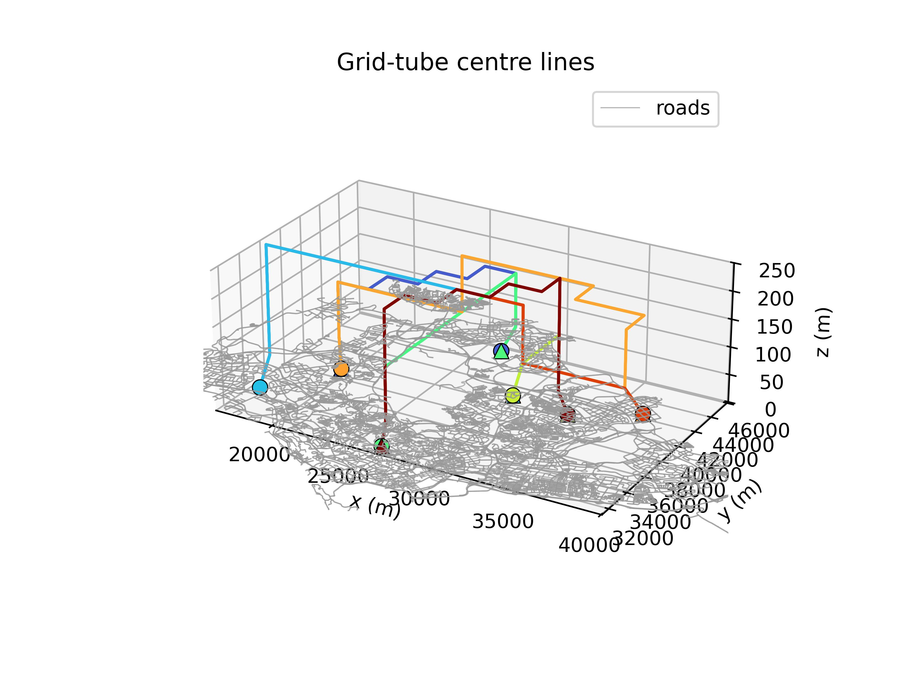
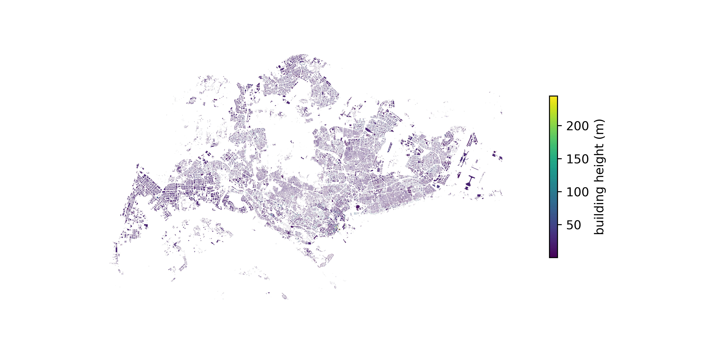
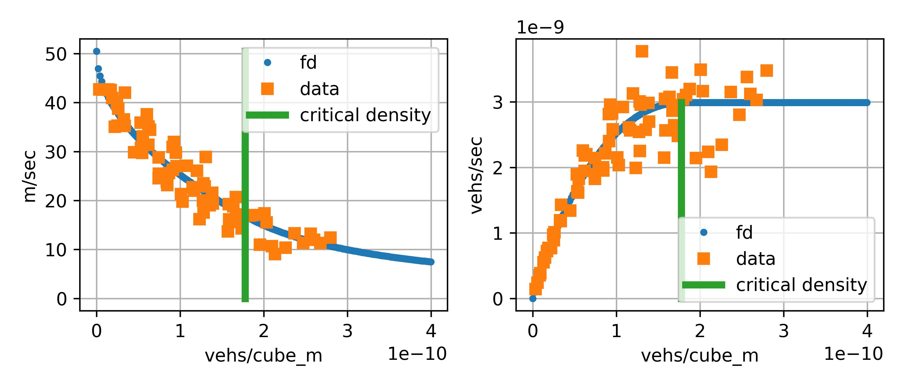

# UAM4dTrafficFlow

A **multiclass 4-D continuum model and solver** for Urban Air Mobility (UAM) traffic
flow with **obstacle awareness**.

The model describes the macroscopic flow of eVTOL aircraft as a multiclass density
field over a 4-D space-time grid (three spatial dimensions + time). Routing is solved
with a fast Eikonal-based method, and the space-time grid is **obstacle-aware** —
buildings and terrain are treated as impenetrable cells (via a validity mask), so
traffic naturally routes around them.

## Paper

> **Multiclass 4D Continuum model and solver for Urban Air Mobility Traffic Flow with
> obstacle awareness**
>
> *Submitted to the 2027 IEEE Intelligent Vehicles Symposium (IV).*

The full source code will be released here **after the paper is accepted**. Until then,
this repository contains the paper's figures and this overview only.

---

## Usage

> The source code is released after paper acceptance — this previews the intended API.

The pipeline has two stages — **modeling** (build the fundamental diagram, the
origin–destination demand, and the obstacle-aware grid) and **solution** (route the
traffic with the multiclass Eikonal solver and trace the resulting trajectories).

### Modeling

**1. Fundamental diagram**

```python
from uam4d_traffic_flow import DrewFD

vf, kj, n = 112.97, 1.6654, 5.76e-17          # Drew FD parameters
kj_m3 = kj / 4168181825.44                     # veh/mile³ -> veh/m³
fd = lambda k: DrewFD.Drew_input_vehs_cube_m_output_meters_secs(k=k, vf=vf, kj=kj, n=n)
```

**2. Origin–destination demand with building heights**

```python
import geopandas as gpd
from uam4d_traffic_flow import generate_24h_flow
from uam4d_traffic_flow import geo_utils as util

buildings = gpd.read_file("singapore_buildings_with_height.gpkg", layer="buildings")
heights, details = util.query_building_heights(droneports_coors, buildings,
                                               return_details=True, height_cols=["height_m"])
flow_ods = generate_24h_flow(originations=droneports_coors, destinations=destinations)
flow_ods = util.combine_height_into_flows_od(flow_ods, details, crs="EPSG:3414")
```

**3. Obstacle-aware space-time grid**

```python
from uam4d_traffic_flow import SpaceTimeUrbanGrid

grid = SpaceTimeUrbanGrid(T=3600, X0=X0, X1=X1, Y0=Y0, Y1=Y1, Z1=1000,
                          deltax=2000, deltay=2000, deltaz=100, deltat=60,
                          crs="EPSG:3414")
grid.set_buildings(buildings.to_crs("EPSG:3414"))
grid.set_od_flows(flow_ods)
grid.build()                       # builds the validity mask (obstacles)
```

### Solution

**4. Convert demand to 4-D and solve the Eikonal routing**

```python
from uam4d_traffic_flow import (extract_peak_hour_demand,
                                flow_to_od_demand_4d,
                                MultiClassContinuumModel3DSolverGivenIrregularGrid)

peak_flow   = extract_peak_hour_demand(flow_ods)
peak_demand = flow_to_od_demand_4d(peak_flow, grid)

solver = MultiClassContinuumModel3DSolverGivenIrregularGrid(grid, fd, rho_max=kj_m3)
res = solver.run(od_demand=peak_demand, nt=60, verbose=True)
# res["rho_total"]  : (nt+1, Nx, Ny, Nz) — grid-level density over time
# res["rho_by_class"]
```

**5. Trace trajectories**

```python
from uam4d_traffic_flow import demand_to_initial_states, group_trajectories_by_grid

initial_states = demand_to_initial_states(peak_flow, grid, include_class=True)
trajs = []
for (orig, dest), entries in initial_states.items():
    for (t, i, j, k, p) in entries:
        cells, faces, times = solver.trace_slot_trajectory(p, i, j, k, t0=t, return_times=True)
        trajs.append({"p": p, "t0": t, "od": (orig, dest),
                      "cells": cells, "faces": faces, "times": times})
```

**6. Tube centre lines & visualisation**

```python
from uam4d_traffic_flow import ContinuumVisualizer
from uam4d_traffic_flow.geo_utils import get_tube_center_lines, plot_center_lines

center_lines = get_tube_center_lines(trajs, grid)   # [origination, centre_0, ..., destination]

viz = ContinuumVisualizer(solver)
viz.plot_density_slice(res["rho_total"][-1], axis="z", index="100m")
plot_center_lines(center_lines)
```

---

## Study area & obstacles

<p align="center">
  
  <br><em>The air-corridor concept over the study area.</em>
</p>

<p align="center">
  
  <br><em>Singapore building footprints — the obstacles the solver routes around.</em>
</p>

## Fundamental diagram

<p align="center">
  
  <br><em>The Drew fundamental diagram (density → speed).</em>
</p>

<p align="center">
  
  <br><em>The no-congestion branch of the Drew FD.</em>
</p>

<p align="center">
  
  <br><em>The fundamental diagram used by the continuum solver.</em>
</p>

## Solver results

<p align="center">
  
  <br><em>The solved density field <code>rho_total</code> over time.</em>
</p>

<p align="center">
  
  <br><em>The Eikonal routing potential field.</em>
</p>

---

## License

[GPL-3.0-or-later](LICENSE) — the license file accompanies the source-code release.
