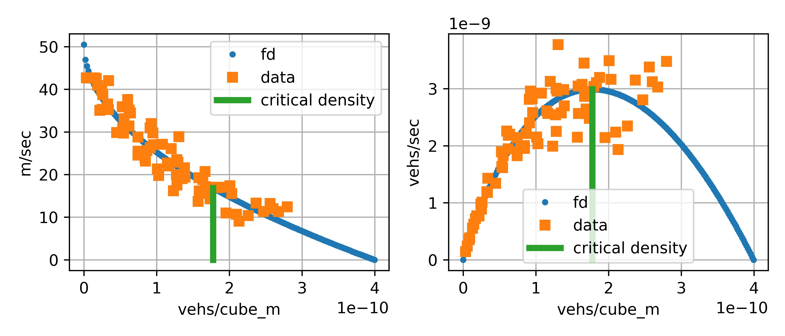
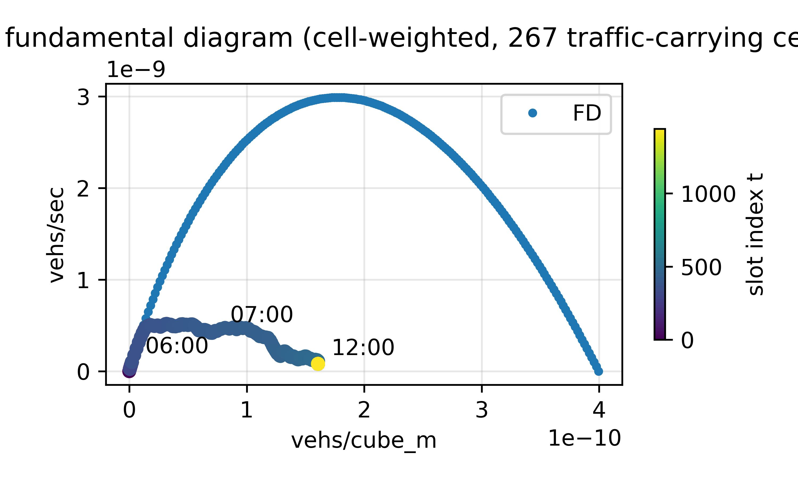
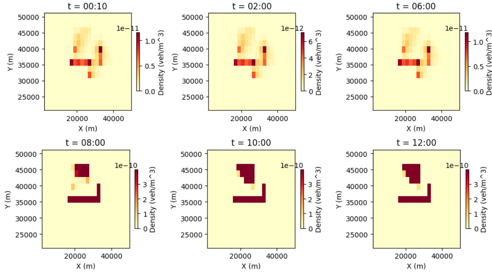
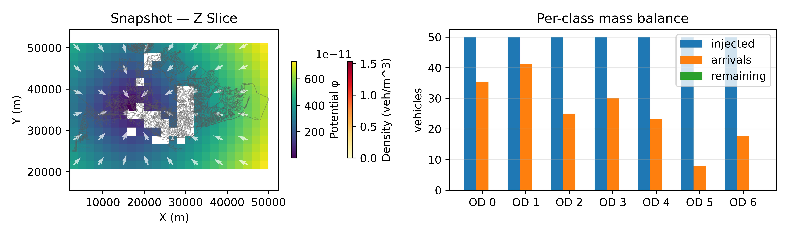

# UAM4dTrafficFlow

A **multiclass 4-D continuum model and solver** for Urban Air Mobility (UAM) traffic
flow with **obstacle awareness**.

The model describes the macroscopic flow of eVTOL aircraft as a multiclass density
field over a 4-D space-time grid (three spatial dimensions + time). Routing is solved
with a fast Eikonal-based method, and the space-time grid is **obstacle-aware** —
buildings and terrain are treated as impenetrable cells (via a validity mask), so
traffic naturally routes around them.

## Paper

> **Multiclass 4D Continuum model and solver for Urban Air Mobility Traffic Flow with
> obstacle awareness**
>
> *Submitted to the 2027 IEEE Intelligent Vehicles Symposium (IV).*

The full source code will be released here **after the paper is accepted**. Until then,
this repository contains the paper's figures and this overview only.

---

## Study area & obstacles

  
   <em>The air-corridor concept over the study area.</em>

  
   <em>Singapore building footprints — the obstacles the solver routes around.</em>

## Fundamental diagram

  
   <em>The Drew fundamental diagram (density → speed).</em>

  
   <em>The no-congestion branch of the Drew FD.</em>

  
   <em>The fundamental diagram used by the continuum solver.</em>

## Solver results

  
   <em>The solved density field <code>rho_total</code> over time.</em>

  
   <em>The Eikonal routing potential field.</em>

---

## License

[GPL-3.0-or-later](LICENSE) — the license file accompanies the source-code release.
